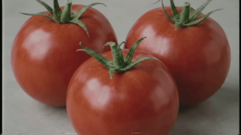

<!-- ═══════════════════════════  HERO GIF  ═══════════════════════════ -->

<h1 align="center">MAKIT JENAMIN</h1>

  
  
  

<!-- ═══════════════════════════  SOCIALS  ═══════════════════════════ -->

  
  
  
  
  
  

## About

hello.

i'm makit, a fullstack software engineer in vietnam.\
i build web and mobile apps that need to scale.\
i like to break problems down to first principles, then build them back up.

i mostly write javascript and typescript: react, next.js and react native on the front,\
node.js and nestjs on the back.

right now i'm learning system architecture, microservices and ai integration.\
i'm open to working on open-source projects and new web or mobile products.\
ask me about js/ts, react, next.js, node.js, nestjs or databases.

i debug faster after the second cup of coffee.

-- makit

## 🧰 Tech Arsenal

<table align="center">
  <tr>
    <td align="center" width="170"><b>🌐 Languages</b></td>
    <td>
      
    </td>
  </tr>
  <tr>
    <td align="center"><b>🎨 Frontend & Mobile</b></td>
    <td>
       
      
      
      
      
    </td>
  </tr>
  <tr>
    <td align="center"><b>⚙️ Backend</b></td>
    <td>
       
      
    </td>
  </tr>
  <tr>
    <td align="center"><b>🗄️ Database & Cache</b></td>
    <td>
       
      
    </td>
  </tr>
  <tr>
    <td align="center"><b>🛠️ DevOps & Tools</b></td>
    <td>
       
      
      
    </td>
  </tr>
</table>

## 🐍 Contribution Snake

  <picture>
    <source media="(prefers-color-scheme: dark)" srcset="https://raw.githubusercontent.com/MakitJenamin/MakitJenamin/output/github-snake-dark.svg" />
    <source media="(prefers-color-scheme: light)" srcset="https://raw.githubusercontent.com/MakitJenamin/MakitJenamin/output/github-snake.svg" />
    
  </picture>

<!-- ═══════════════════════════  FOOTER  ═══════════════════════════ -->

  <i>“If you can't explain it simply, you don't understand it well enough.”</i>

  

